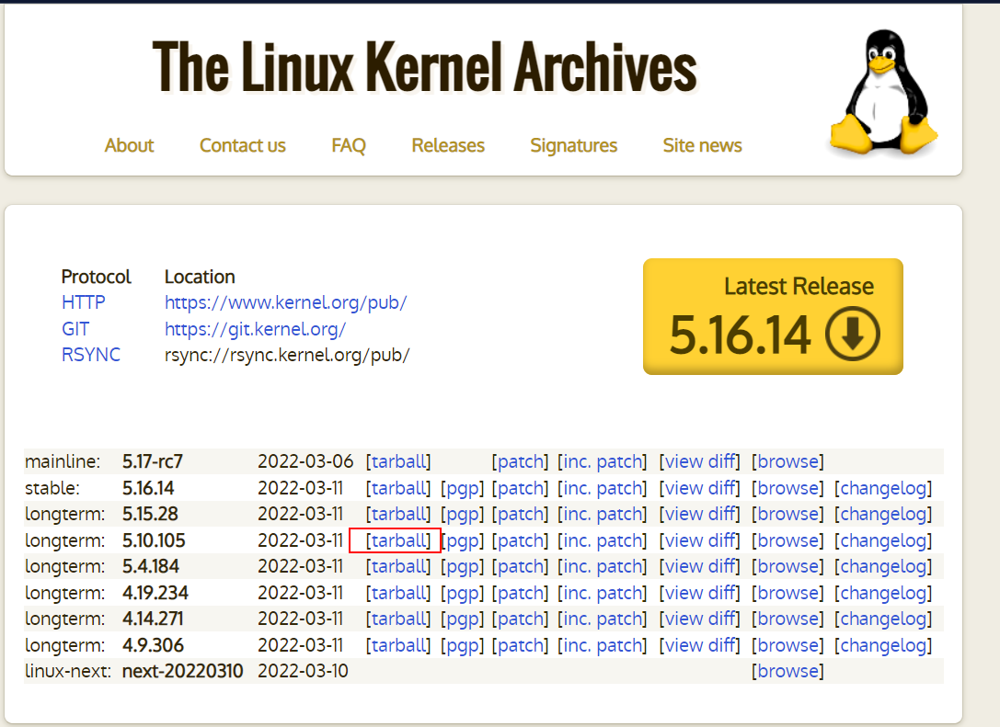
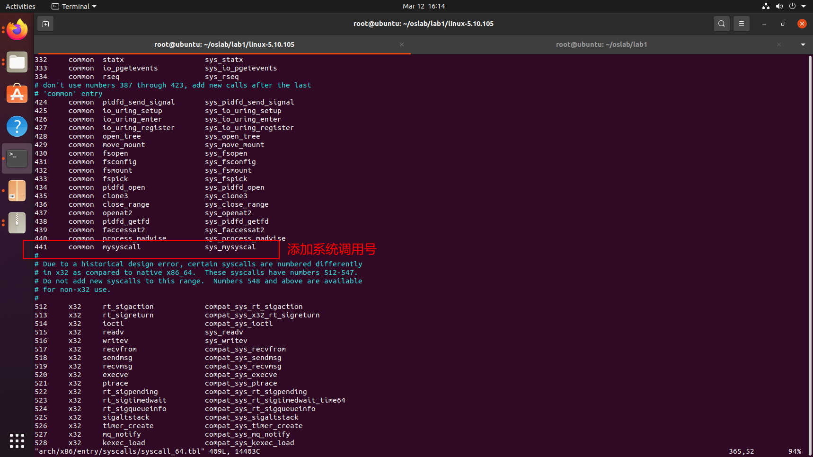
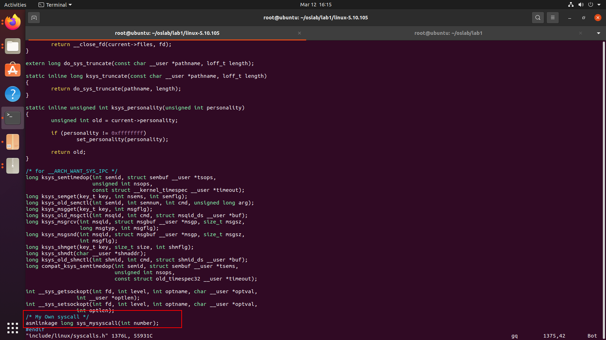
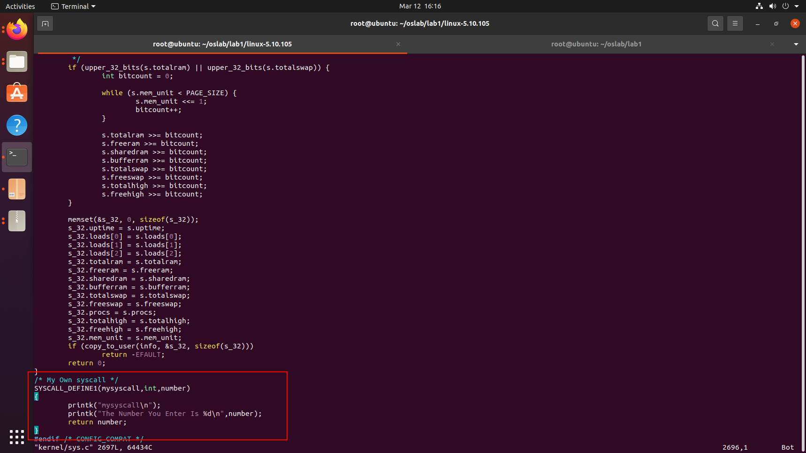
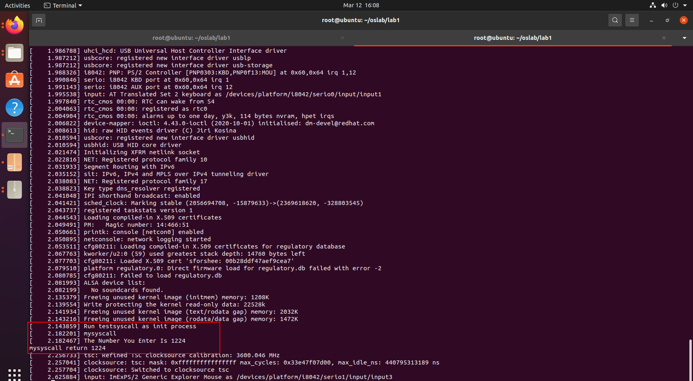

# Lab1 添加系统调用
---
<center>
    任课老师：陈鹏飞
<br>    
    助教：李晓芸、余广坝
</center>

## 实验要求

1. 在Linux操作系统内核如5.10或者Linux 0.11 中添加新的系统调用，并且编译、启动新的内核，测试新加入的系统调用的有效性
2. 编写实验报告、结合实验过程来谈谈你完成实验的思路和结果，最后需要提供实验的新加入系统调用的运行结果截屏来证明你完成了实验。
3. 实验不限语言， C/C++/Rust都可以。
4. 实验不限平台， Windows、Linux和MacOS等都可以。
5. 实验不限CPU， ARM/Intel/Risc-V都可以。

注意： 编译调试内核比较繁琐，可以利用[操作系统实验1](https://gitee.com/nelsoncheung/sysu-2021-spring-operating-system/tree/main/lab1)中学到的知识，利用qemu 启动新的内核，同时编写测试程序，制作initramfs启动测试程序，观察结果，并利用gdb远程调试。当然也可以不用qemu，利用Virtualbox启动新的内核操作系统, 测试系统调用。

本指导的添加系统调用方式只是诸多方式的一种，同学们可以自由选择其他方式添加系统调用。

## 安装依赖
---
```
sudo apt-get update && sudo apt-get upgrade
sudo apt install binutils
sudo apt install gcc
sudo apt install nasm
sudo apt install qemu
sudo apt install cmake
sudo apt-get install libc6-dev
sudo apt-get install libelf-dev
sudo apt-get install libncurses5-dev libssl-dev
sudo apt-get install build-essential openssl
sudo apt-get install libidn11-dev libidn11
sudo apt-get install zlibc minizip
sudo apt-get install bison
sudo apt-get install flex
sudo apt-get install pkg-config
```

由于ubuntu的下载源默认是国外的，为了提高下载速度，同学们可将下载源更换为国内的[清华镜像源](https://mirror.tuna.tsinghua.edu.cn/help/ubuntu/)。


## 添加系统调用
---

下载 linux 5.10 内核包




解压内核包
```
tar -xvf linux-5.10.105.tar
cd linux-5.10.105/
```

添加自定义的系统调用
```
sudo vim arch/x86/entry/syscalls/syscall_64.tbl

441     common  mysyscall               sys_mysyscall
```




```
sudo vim include/linux/syscalls.h

/* My Own syscall */
asmlinkage long sys_mysyscall(int number);
```


添加一个数字作为参数，打印该数字的系统调用
```
sudo vim kernel/sys.c

/* My Own syscall */
SYSCALL_DEFINE1(mysyscall,int,number)
{
        printk("mysyscall\n");
        printk("The Number You Enter Is %d\n",number);
        return number;
}
```


## 编译内核

```
cd linux-5.10.105/
```

删除所有的编译生成文件、内核配置文件和各种备份文件

```
sudo make mrproper
```

删除前一次编译过程中残留的数据

```
sudo make clean
```

配置文件, 配置文件，直接exit，然后按enter键

```
make x86_64_defconfig
sudo make menuconfig
```

编译内核，j后面代表分配核心数，这一步比较慢

```
sudo make -j8
```

检查Linux压缩镜像linux-5.10.105/arch/x86_64/boot/bzImage和符号表linux-5.10.105/vmlinux是否已经生成。

## 制作 Initramfs

制作一个简单的调用新系统调用的 testsyscall initramfs，测试系统调用是否添加成功

```
cd linux-5.10.105/
vim testsyscall.c

#include <linux/kernel.h>
#include <sys/syscall.h>
#include <unistd.h>
#include <stdio.h>

void main()
{
        //441:long sys_mysyscall(int)
        long temp;
        temp = syscall(441,1224);
        printf("mysyscall return %ld\n",temp);
        fflush(stdout);
        /* 让程序打印完后继续维持在用户态 */
        while(1);
}
```

将代码编译成可执行文件
```
gcc -o testsyscall -static testsyscall.c
```

用 cpio 打包 initramfs
```
echo testsyscall |  cpio -o --format=newc >  testsyscall-initramfs
```

## 启动内核

启动内核，加载initramfs, 并开启远程调试

```
cd linux-5.10.105/
qemu-system-x86_64 -kernel linux-5.10.105/arch/x86_64/boot/bzImage -initrd testsyscall-initramfs -s -S -append "console=ttyS0 rdinit=testsyscall" -nographic
```

此时，同学们会发现qemu并未输出任何信息。这是因为我们开启了gdb调试，而qemu在等待gdb输入的指令后才能继续执行。接下来我们启动gdb，通过gdb来告诉qemu应该怎么做。

## gdb 调试

在另外一个Terminal下启动gdb，注意，不要关闭qemu所在的Terminal。

```
cd linux-5.10.105/
gdb
```

在gdb下，加载符号表
```
file linux-5.10.105/vmlinux
```

在gdb下，连接已经启动的qemu进行调试

```
target remote:1234
```

在gdb下，为start_kernel函数设置断点。
```
break start_kernel
```

在gdb下，输入c运行。
```
c
```

## 运行结果

最终qemu的输出如下，在qemu虚拟机里运行的Linux系统能成功启动, 并打印出测试程序的数字


